<div align="center">

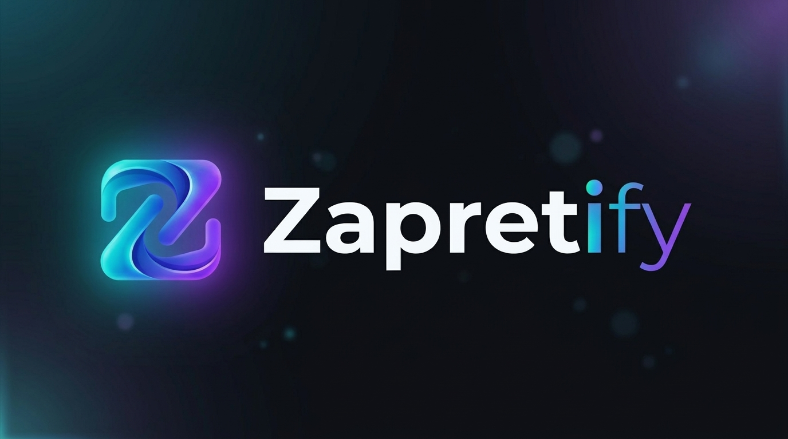

# Zapretify

**Единый графический центр управления обходом блокировок для Windows**

### Симбиоз технологий `zapret` и `tg-ws-proxy` в одном приложении

[](https://go.dev)
[-0078D6?style=flat&logo=windows)](https://microsoft.com)
[](../../releases/tag/v1.4.2)
[](LICENSE)
[](#roadmap)
[-orange)](https://github.com/Flowseal/zapret-discord-youtube)
[](https://github.com/Flowseal/tg-ws-proxy)

*Легковесное десктопное приложение на Go и WebView2 (~15 МБ ОЗУ), объединяющее низкоуровневую десинхронизацию DPI (YouTube, Discord) и защищенный WebSocket-прокси для Telegram.*

[О концепции](#about) • [Интерфейс](#interface) • [Два ядра проекта](#cores) • [Возможности](#features) • [Планы развития](#roadmap) • [Установка](#install) • [Использование](#usage) • [Сборка](#build) • [Первоисточники](#credits)

</div>

---

<a id="about"></a>

##  О концепции Zapretify

Большинство существующих решений для обхода цензуры решают задачи фрагментарно:
- Для оживления **YouTube** и **Discord** пользователи запускают консольные `.bat`-скрипты на базе `zapret`.
- Для стабильной работы **Telegram** в условиях блокировок протокола MTProto и IP-адресов дата-центров поднимают отдельные WebSocket-мосты (`tg-ws-proxy`) или ищут сторонние прокси.

Запуск нескольких разрозненных скриптов, командных строк и фоновых процессов неудобен, нагружает систему и требует регулярного ручного обслуживания.

**Zapretify** решает эту проблему, объединяя под единым управлением **два принципиально разных инструмента обхода блокировок**:
1. **Низкоуровневый драйверный перехватчик `zapret`** (ядро bol-van + пакет актуальных стратегий Flowseal).
2. **Прикладной прокси-мост `tg-ws-proxy`** (WebSocket / Fake-TLS туннелирование для Telegram).

Оба инструмента управляются единым оркестратором на Go, имеют независимые тумблеры переключения, не конфликтуют между собой и доступны через современный графический интерфейс с поддержкой системного трея Windows.

---

<a id="interface"></a>

##  Интерфейс приложения

<div align="center">

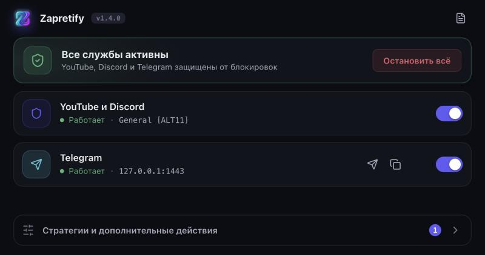

*Главный экран: общий статус, переключатели Zapret и Telegram-прокси, подключение Telegram в один клик*

</div>

С версии **1.4.0** у Zapretify компактный интерфейс в окне **720×380**: всё управление — на одном экране, настройки открываются в окнах-диалогах, а редкие действия собраны в меню **«Стратегии и дополнительные действия»**.

<table>
<tr>
<td align="center" width="50%">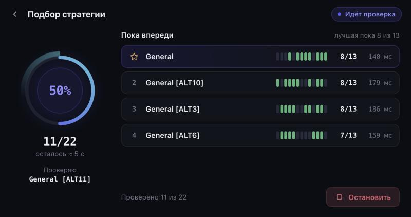<br><sub>Подбор стратегии: таблица лидеров обновляется на лету</sub></td>
<td align="center" width="50%">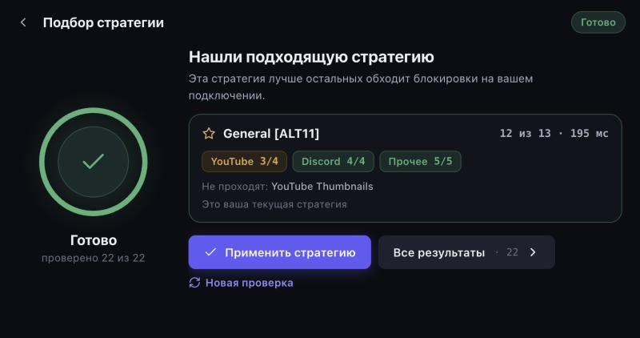<br><sub>Итог подбора с разбивкой по YouTube, Discord и остальным сайтам</sub></td>
</tr>
<tr>
<td align="center">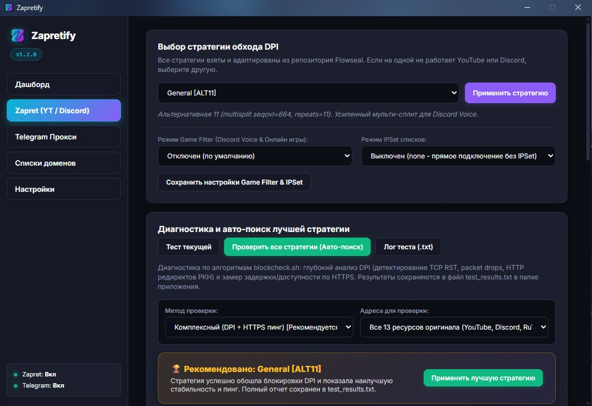<br><sub>Настройки Zapret: стратегия, служба Windows, Game Filter, IPSet</sub></td>
<td align="center">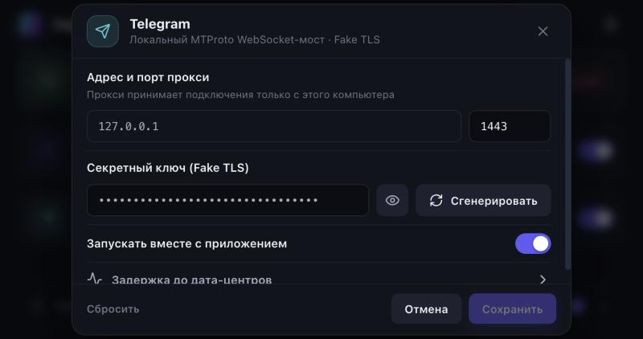<br><sub>Настройки Telegram-прокси: порт и скрытый секретный ключ</sub></td>
</tr>
<tr>
<td align="center">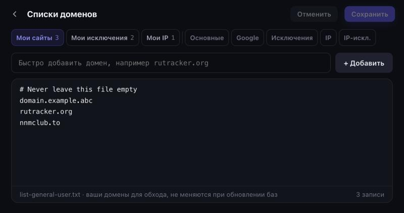<br><sub>Списки доменов: свои сайты не перезаписываются при обновлении баз</sub></td>
<td align="center">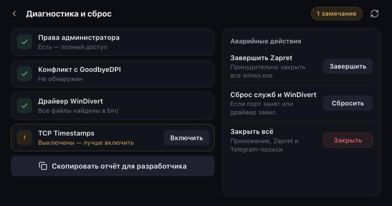<br><sub>Диагностика системы и аварийные действия</sub></td>
</tr>
</table>

---

<a id="cores"></a>

##  Два фундаментальных ядра проекта

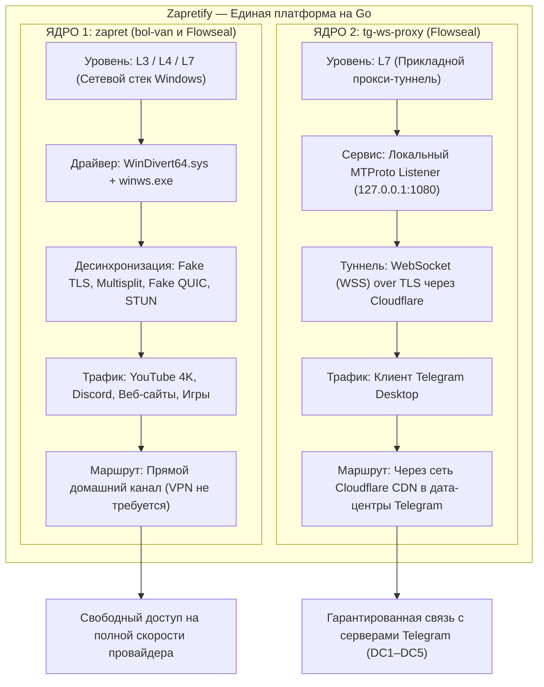

| Характеристика | ЯДРО 1: `zapret` (bol-van & Flowseal) | ЯДРО 2: `tg-ws-proxy` (Flowseal) |
|---|---|---|
| **Сетевой уровень** | **L3 / L4 / L7** (Сетевой стек Windows) | **L7** (Прикладной прокси-мост) |
| **Механизм работы** | Драйвер ядра **WinDivert** + десинхронизация пакетов | Локальный TCP-сервер -> WebSocket over TLS через Cloudflare |
| **Что защищает** | **YouTube**, **Discord** (включая голос), сайты, игры | Мессенджер **Telegram Desktop** |
| **Внешний сервер** | **Не требуется** (100% скорости домашнего канала) | Cloudflare Edge CDN / Workers |
| **Первоисточники** | [bol-van/zapret](https://github.com/bol-van/zapret)<br>[Flowseal/zapret-discord-youtube](https://github.com/Flowseal/zapret-discord-youtube) | [Flowseal/tg-ws-proxy](https://github.com/Flowseal/tg-ws-proxy) |

### 1. Ядро `zapret` (bol-van) с базой стратегий Flowseal
- **Что это**: мощнейший инструмент обхода DPI (глубокого анализа пакетов) без маршрутизации трафика через удаленные VPN-серверы.
- **Как это устроено**:
  - Использует подписанный драйвер уровня ядра **WinDivert** (`WinDivert.dll`, `WinDivert64.sys`) для фильтрации и модификации исходящих пакетов TCP/UDP прямо на сетевой карте.
  - Утилита `winws.exe` выполняет десинхронизацию пакетов: разбивает TLS ClientHello на части (`split`, `multisplit`, `fakedsplit`), генерирует фиктивные пакеты с заниженным TTL/SEQ (`fake`, `badseq`), подменяет SNI на разрешенные (`www.google.com`, `ya.ru`) и модифицирует QUIC/STUN пакеты для YouTube и Discord.
  - Наработки **Flowseal** предоставляют набор **адаптированных стратегий** под реалии ТСПУ российских операторов и актуальные базы доменов (`list-general.txt`, `list-google.txt`, `ipset-all.txt`).
- **Задачи в Zapretify**: полное восстановление скорости YouTube (воспроизведение 4K 60fps), разблокировка голосовых каналов и звонков Discord, доступ к сайтам без снижения скорости провайдера.

### 2. Ядро `tg-ws-proxy` (Telegram WebSocket Proxy)
- **Что это**: специализированный локальный прокси-сервер, разработанный для гарантированной доставки трафика Telegram через любые сетевые фильтры.
- **Как это устроено**:
  - Клиент Telegram подключается к локальному адресу (по умолчанию `127.0.0.1:1080` или `1443`).
  - Прокси принимает бинарный поток MTProto и инкапсулирует его в защищенное **WebSocket (WSS)** соединение с шифрованием TLS.
  - Трафик направляется через глобальную сеть CDN **Cloudflare** (Cloudflare Workers / Edge Nodes).
  - Для интернет-провайдера и систем ТСПУ этот трафик выглядит как легитимный HTTPS/WSS веб-серфинг на доверенные адреса Cloudflare. Блокировка стандартных портов и IP-диапазонов Telegram перестает действовать.
- **Задачи в Zapretify**: мгновенное подключение Telegram к дата-центрам (DC1–DC5), быстрая загрузка медиафайлов и стабильные звонки даже в условиях точечной блокировки протокола MTProto.

---

<a id="how-it-works"></a>

##  Как это работает внутри Zapretify

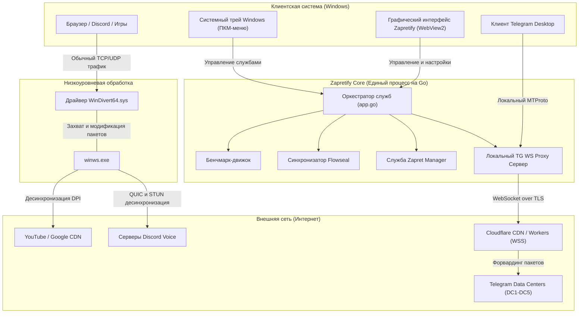

### Принципы интеграции:
1. **Разделение зон ответственности**:
   - Трафик браузеров, Discord и системы идет напрямую через сетевую карту, где драйвер `WinDivert` «на лету» изменяет пакеты для обхода DPI без потери скорости.
   - Трафик Telegram идет в локальный порт `tgproxy`, где преобразуется в защищенный WebSocket-туннель.
2. **Исключение взаимного влияния**:
   - В списки исключений Zapret (`ipset-exclude.txt`, `list-exclude.txt`) занесены порты и служебные адреса прокси, что предотвращает двойную модификацию трафика.
3. **Единый мониторинг и управление**:
   - Состояния обоих сервисов опрашиваются асинхронно. В системном трее и на главном экране всегда отображаются актуальные тумблеры: можно держать включенным только Zapret, только TG-прокси, либо оба сразу.
4. **Подключение Telegram в один клик**:
   - Приложение автоматически генерирует персональную ссылку формата `tg://proxy?server=127.0.0.1&port=...&secret=...`. Кнопка в интерфейсе сразу открывает Telegram с готовым диалогом включения прокси.

---

<a id="features"></a>

##  Возможности

###  Компактный интерфейс и интеграция с Windows
- **Окно 720×380**: один главный экран вместо вкладок, настройки в окнах-диалогах, редкие действия — в нижнем меню.
- **Корректный масштаб**: размер окна считается по клиентской области с учётом масштаба Windows (100–200%), при переносе на монитор с другим DPI окно пересчитывается.
- **Тёмная тема и DWM Dark Mode**: тёмный заголовок окна Windows, единая палитра (индиго — действия, зелёный — работает, янтарный — внимание, красный — ошибка).
- **Системные шрифты** (Segoe UI, Cascadia Mono / Consolas): интерфейс ничего не загружает из интернета и одинаково выглядит без сети.
- **Подписи для экранного диктора** и всплывающие подсказки у всех кнопок-иконок; поддержка режима «уменьшить анимацию».
- **Минимальное потребление памяти**: легковесный движок на Go + WebView2 требует всего ~15–20 МБ ОЗУ (в отличие от Electron-аналогов на 200+ МБ).

###  Управление из системного трея (ПКМ)
- Сворачивание по нажатию кнопки минимизации или закрытия.
- **Интерактивное контекстное меню**:
  - `Открыть Zapretify`;
  - `Включить / Выключить Zapret` (динамический статус);
  - `Включить / Выключить Telegram прокси` (динамический статус);
  - `Выход` с чистым завершением дочерних процессов.
- Информативный тултип при наведении курсора.

###  Подбор и проверка стратегий
- **Подбор лучшей**: поочерёдная проверка всех стратегий Flowseal по выбранным целям (YouTube и Discord · 8, все · 13, Blockcheck · 5) и методу (полный, только DPI, только HTTPS).
- **Живая таблица лидеров** с оценкой оставшегося времени; подбор можно остановить в любой момент — лучшие из проверенных сохраняются.
- **Понятный итог**: лучшая стратегия, сколько целей открылось, разбивка по YouTube / Discord / прочему и список того, что не проходит.
- **Проверка одной стратегии** за несколько секунд — например, той, что выбрана вручную.
- **Результат сохраняется** (`last_benchmark.json`): «Прошлый подбор» и подсказка «Лучшая по подбору» видны и после перезапуска.
- Подробный отчёт пишется в `test_results.txt`.

<div align="center">
  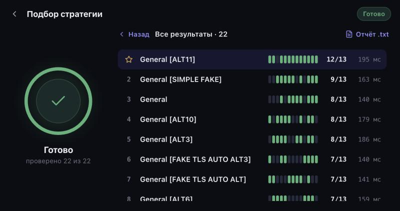
</div>

###  Автообновление баз и стратегий из Flowseal
- Синхронизация баз списков хостов (`list-general.txt`, `list-google.txt`, `list-exclude.txt`, `ipset-exclude.txt`) и IP-листа для режима IPSet «Загружен».
- Загрузка и разбор актуальных сценариев `.bat` из репозитория Flowseal, горячее обновление `strategies.json` без перезапуска приложения.
- Докачка новых и изменённых файлов фейков `bin/*.bin` с проверкой контрольной суммы.
- Подробный отчёт: какие стратегии добавлены или изменены, какие списки и фейки обновились, или «Файлы актуальны».
- **Свои списки не трогаются**: `list-general-user.txt`, `list-exclude-user.txt` и `ipset-exclude-user.txt` («Мои сайты», «Мои исключения», «Мои IP») никогда не перезаписываются.

###  Списки доменов
- Редактор своих списков с быстрым добавлением: можно вставить ссылку целиком (`https://www.site.org/page` → `site.org`), формат и дубли проверяются, добавление можно отменить.
- Базы Flowseal открываются только для просмотра — свои сайты всегда идут в «Мои сайты».
- После сохранения можно сразу перезапустить Zapret, чтобы winws перечитал списки.

###  Режим системной службы Windows
- Zapret запускается либо как процесс приложения, либо как служба Windows (`sc.exe`) — переключатель **«Запускать как службу Windows»** в настройках Zapret.
- Служба работает с включения компьютера, даже без открытого приложения и без окна UAC.
- Автозапуск самого приложения настраивается отдельно в **«Настройках приложения»** (через планировщик задач, без запроса UAC).

###  Мгновенный запуск и защита от дубликатов (Single Instance)
- **Проверка до вызова UAC**: программа определяет наличие запущенного экземпляра через Win32 Mutex до запроса повышенных прав. Повторный клик по ярлыку не вызывает системный экран подтверждения UAC, а сразу выводит активное окно на передний план.
- **Интеллектуальная фильтрация окон**: исключен ошибочный фокус на окнах Проводника Windows (`CabinetWClass`), если открыта папка с названием «Zapretify».

###  Изолированное управление процессами и стабильность
- **Точечный учёт PID (`winws.pid`)**: приложение отслеживает свой процесс `winws.exe` и завершает только его, не затрагивая другие сетевые утилиты (GoodbyeDPI и др.).
- **Свободный фильтр перед запуском**: если тот же фильтр WinDivert держит служба `zapret` или оставшийся `winws.exe` из папки приложения, они останавливаются автоматически; про чужой `winws.exe` из другой папки приложение сообщает понятной ошибкой.
- **Автоматическая зачистка «сирот» (`CleanupOrphans`)**: после аварийного закрытия или перезагрузки зависший процесс завершается по сохранённому PID.
- **Диагностика и аварийный сброс**: проверка прав администратора, конфликта с GoodbyeDPI, файлов WinDivert и TCP Timestamps; «Завершить Zapret», «Сброс служб и WinDivert», «Закрыть всё» с подтверждением повторным нажатием.

###  Мастер установки с режимом обновления (In-Place Upgrade)
- Графический установщик автоматически сканирует реестр Windows на наличие предыдущих версий.
- При обнаружении установленного приложения мастер предлагает обновить его в один клик с гарантированным сохранением ваших настроек (`config.json`) и персональных списков доменов.

###  Защита локального API и данных
- **Сессионный токен (`X-Zapretify-Token`)**: все запросы интерфейса авторизуются криптографическим токеном с валидацией за константное время. Токен передается строго в заголовках.
- **Блокировка межсайтовых запросов**: строгая проверка заголовков `Host` (защита от DNS Rebinding) и `Origin` (блокировка внешних сайтов и iframe-песочниц `null`, `file://`, `data:`).
- **Безопасные пути**: редактор списков работает исключительно с `.txt` файлами внутри папки `lists/`, блокируя попытки выхода за пределы каталога, потоки данных NTFS (`:`) и зарезервированные системные устройства Windows (`CON`, `PRN`, `AUX`, `NUL` и др.).
- **Внешние ссылки в браузере по умолчанию**: клики по ссылкам (GitHub, Telegram) открывают стандартный браузер пользователя через нативный системный вызов Windows `ShellExecuteW`.
- **Без внешних источников**: политика CSP разрешает загрузку только с самого приложения.

---

<a id="install"></a>

##  Установка и запуск

### Вариант 1: Portable-версия (без установки)
1. Скачайте архив **`Zapretify-Portable-v1.4.2.zip`** из раздела [Releases](../../releases).
2. Распакуйте архив в удобный каталог (например, `C:\Program Files\Zapretify` или `D:\Tools\Zapretify`).
3. Запустите **`Zapretify.exe`** от имени администратора.

### Вариант 2: Установщик Windows (Setup.exe)
1. Скачайте и запустите **`Zapretify-Setup-v1.4.0.exe`** из раздела [Releases](../../releases).
2. Программа установки:
   - Автоматически распознает уже установленную версию программы и предложит ее обновление с сохранением пользовательских настроек и списков;
   - Автоматически предложит оптимальный путь установки с возможностью выбора другой папки;
   - Создаст ярлыки на рабочем столе и в меню «Пуск»;
   - Предложит автозапуск приложения при входе в Windows;
   - Корректно зарегистрирует программу в системе для чистого удаления через стандартные «Параметры Windows -> Приложения».

> **Обратите внимание**: для перехвата сетевых пакетов драйвер **WinDivert** требует права локального администратора. Приложение запросит UAC при старте.

---

<a id="usage"></a>

##  Руководство по использованию

### 1. Главный экран
- **«Включить всё» / «Остановить всё»** — запуск и остановка Zapret и Telegram-прокси одной кнопкой.
- **Переключатели «YouTube и Discord» и «Telegram»** — каждая служба управляется отдельно. Под названием видно состояние и текущую стратегию или адрес прокси.
- **Клик по строке службы** (или по значку шестерёнки) открывает её настройки.
- **Значок журнала** в правом верхнем углу открывает журнал событий; красная точка на нём означает новые ошибки.
- **Бейдж версии** показывает, есть ли обновление.
- **«Стратегии и дополнительные действия»** — меню с подбором стратегий, списками, диагностикой, журналом, настройками приложения и обновлениями. Цифра на кнопке — сколько разделов требуют внимания.

<div align="center">
  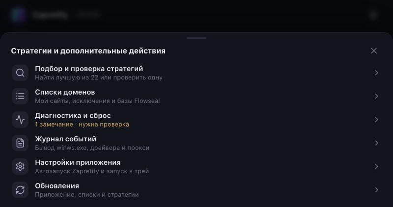
</div>

### 2. Подбор стратегии для YouTube и Discord
1. Откройте **«Стратегии и дополнительные действия» → «Подбор и проверка стратегий»**.
2. Режим **«Подобрать лучшую»** проверит все стратегии; **«Проверить одну»** — только выбранную. Кнопка с параметрами рядом со стартом задаёт цели и метод проверки.
3. Нажмите **«Начать подбор»**. На время проверки Zapret приостанавливается и потом включается сам, Telegram-прокси это не затрагивает. Подбор можно остановить кнопкой **«Остановить»**.
4. В итоге нажмите **«Применить стратегию»** — Zapret запустится с ней. **«Все результаты»** покажет полный рейтинг, а **«Новая проверка»** вернёт к выбору режима.

<div align="center">
  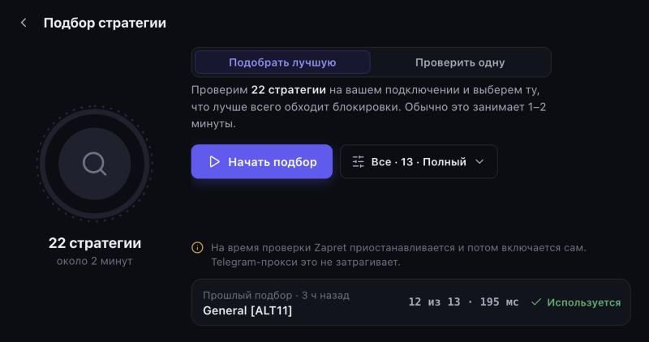
</div>

### 3. Настройки Zapret
1. Нажмите на строку **«YouTube и Discord»** на главном экране.
2. Выберите стратегию вручную или нажмите **«Выбрать»** рядом с лучшей по подбору; **«Проверить»** быстро проверит выбранную стратегию.
3. Включите **«Запускать как службу Windows»**, чтобы обход работал с включения ПК без открытого приложения (нужны права администратора).
4. В разделе **«Дополнительно»** — Game Filter (Discord Voice и онлайн-игры), диапазоны портов и режим IPSet.
5. Нажмите **«Сохранить»**: если Zapret работает, он перезапустится с новыми параметрами.

### 4. Свои сайты и исключения
1. Откройте **«Списки доменов»**.
2. Во вкладке **«Мои сайты»** добавьте домен в поле **«Быстро добавить»** или отредактируйте список вручную и нажмите **«Сохранить»**.
3. Сайты, которые должны идти напрямую, добавляйте в **«Мои исключения»**, IP-адреса и подсети — в **«Мои IP»**.
4. Если Zapret запущен, нажмите **«Перезапустить Zapret»** внизу редактора, чтобы применить списки.

### 5. Telegram-прокси
1. Включите переключатель **«Telegram»** на главном экране.
2. Нажмите значок **«Открыть в Telegram»** рядом с переключателем (или скопируйте ссылку соседним значком) и подтвердите добавление прокси в Telegram.
3. В настройках (клик по строке «Telegram») можно сменить порт и сгенерировать новый секретный ключ — после смены ключа добавьте прокси в Telegram заново. В разделе **«Задержка до дата-центров»** — замер пинга до DC1–DC5.

<div align="center">
  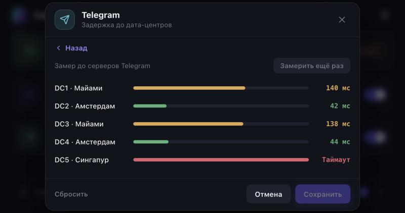
</div>

### 6. Диагностика, журнал и обновления
- **«Диагностика и сброс»** — проверка прав администратора, GoodbyeDPI, WinDivert и TCP Timestamps с кнопками исправления, копирование отчёта для разработчика и аварийные действия.
- **«Журнал событий»** — фильтр «Все / Предупреждения / Ошибки», автопрокрутка и очистка.
- **«Обновления»** — проверка новой версии на GitHub и обновление баз Flowseal; ваши списки при этом не меняются.
- **«Настройки приложения»** — автозапуск Zapretify при входе в Windows и запуск свёрнутым в трей.

<table>
<tr>
<td align="center" width="50%">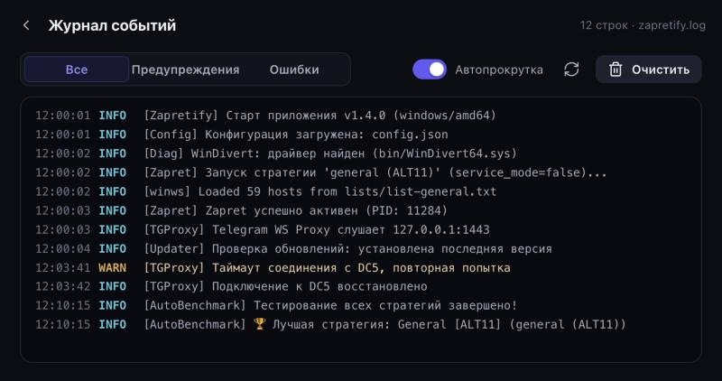</td>
<td align="center" width="50%">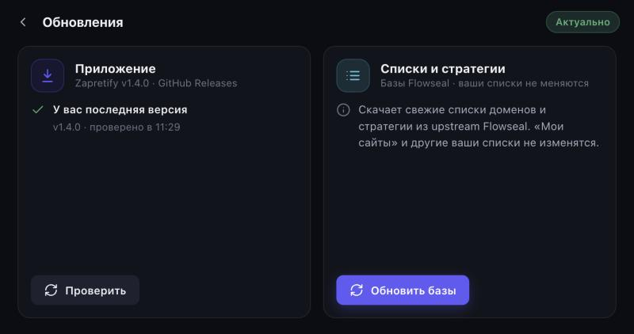</td>
</tr>
</table>

---

<a id="build"></a>

##  Сборка из исходников

### Требования
- **Go**: версия `1.26` или новее (см. `go.mod`).
- **ОС**: Windows 10/11 x64, macOS или Linux (с поддержкой Go cross-compilation).

### Компиляция
```bash
# Кросс-компиляция из Linux или macOS:
GOOS=windows GOARCH=amd64 go build -ldflags="-s -w -H=windowsgui" -o Zapretify.exe .

# Нативная компиляция в Windows:
go build -ldflags="-s -w -H=windowsgui" -o Zapretify.exe .

# Сборка инсталлятора (Setup.exe):
GOOS=windows GOARCH=amd64 go build -ldflags="-s -w -H=windowsgui" -o dist/Zapretify-Setup-v1.4.0.exe ./cmd/installer
```

### Автоматическая сборка дистрибутива
В Windows запустите:
```cmd
build_all.bat
```
Скрипт скомпилирует `Zapretify.exe`, упакует портативный архив `dist/Zapretify-Portable-v1.4.2.zip` и автоматически соберёт инсталлятор `dist/Zapretify-Setup-v1.4.0.exe`.

---

<a id="roadmap"></a>

##  Планы развития (Roadmap)

В текущей версии реализован полнофункциональный клиент для **Windows 10/11 x64**. В дальнейших релизах запланирована активная адаптация и оптимизация под другие платформы:

- [x] **Windows 10 / 11 (x64)**:
  - Полная поддержка WinDivert, системной службы Windows (`sc.exe`), автозапуска, системного трея и графического инсталлятора.
- [ ] **Оптимизация под Linux**:
  - Адаптация ядра под `nfqws` (Netfilter Queue) из оригинального комплекса zapret bol-van;
  - Управление правилами маршрутизации через `iptables` / `nftables` и фоновым сервисом `systemd`;
  - Сборка пакетов `.deb`, `.rpm`, `.AppImage` и поддержка headless CLI-режима.
- [ ] **Оптимизация под macOS**:
  - Интеграция с подсистемой перехвата пакетов macOS через Packet Filter (`pf`) и `divert-sockets`;
  - Нативная сборка универсального бандла `.app` / `.dmg` для архитектур **Apple Silicon (M1–M4 / ARM64)** и **Intel (x86_64)**;
  - Адаптация интерфейса под системный статус-бар macOS (Menu Bar) с темной темой.

---

<a id="structure"></a>

##  Структура репозитория

```text
Zapretify/
├── assets/                   # Иконка приложения (icon.ico) и логотипы
├── bin/                      # Бинарные модули ядра
│   ├── winws.exe             # Исполняемый файл zapret (bol-van)
│   ├── WinDivert.dll         # Библиотека перехвата пакетов WinDivert
│   ├── WinDivert64.sys       # 64-битный драйвер уровня ядра
│   ├── cygwin1.dll           # POSIX-совместимый слой
│   └── *.bin                 # Бинарные пэйлоады (Google SNI, QUIC, Discord STUN)
├── cmd/                      # Точки входа дополнительных утилит
│   └── installer/            # Графический инсталлятор для Windows (Go + WebView2)
│       ├── frontend/         # Веб-интерфейс мастера установки
│       ├── main.go           # Движок распаковки, ярлыков и реестра Windows
│       └── window_windows.go # Win32 окно с темным заголовком DWM
├── core/                     # Исходный код бэкенда (Go)
│   ├── config/               # Менеджер настроек (JSON) и реестр автозапуска
│   ├── logger/               # Потокобезопасный логгер в zapretify.log
│   ├── platform/             # Win32 API, UAC elevation, системная диагностика
│   ├── tgproxy/              # Реализация ядра tg-ws-proxy (WebSocket MTProto bridge)
│   ├── updater/              # Синхронизатор баз и стратегий Flowseal
│   └── zapret/               # Диспетчер процесса winws, WinDivert, бенчмарк, служба
├── docs/                     # Документация (архитектура, безопасность, история версий)
│   ├── icons/                # SVG-иконки разделов README (Lucide, ISC)
│   ├── ARCHITECTURE.md       # Подробное описание технической архитектуры
│   ├── CHANGELOG.md          # История версий и изменений
│   └── SECURITY.md           # Модель безопасности и контакты
├── frontend/                 # Пользовательский интерфейс (Single Page Application)
│   └── dist/index.html       # Интерфейс 1.4.0: HTML5/CSS3/Vanilla JS в одном файле
├── lists/                    # Списки хостов и IP-диапазонов Flowseal
├── packaging/                # Резервные скрипты установщика Inno Setup (installer.iss)
├── screens/                  # Скриншоты интерфейса для README
├── api.go                    # Внутренний HTTP REST API для связи GUI с Go-ядром
├── app.go                    # Главный контроллер приложения и фасад управления
├── build_all.bat             # Скрипт сборки Portable архива и инсталлятора
├── main.go                   # Точка входа приложения, встроенный веб-сервер
├── open_browser_windows.go   # Безопасное открытие URL в браузере Windows (ShellExecuteW)
├── open_browser_other.go     # Открытие URL для кросс-платформенного запуска
├── security_middleware.go    # Защита локального API: токен X-Zapretify-Token, Host/Origin
├── single_instance_windows.go# Быстрый повторный запуск (OpenMutex) без вызова UAC
├── single_instance_other.go  # Заглушка проверки экземпляра для других ОС
├── strategies.json           # Локальная база стратегий Flowseal
├── window_windows.go         # Интеграция с Win32: WebView2, системный трей, DWM Dark Mode
├── window_dpi_windows.go     # Размер окна по клиентской области с учётом DPI монитора
└── window_other.go           # Заглушки для кросс-платформенной компиляции
```

---

<a id="credits"></a>

##  Первоисточники и лицензии

Проект **Zapretify** выражает глубокую признательность авторам базовых технологий:

1. **[bol-van/zapret](https://github.com/bol-van/zapret)** *(ядро winws v72.9)*  
   *Автор: bol-van*  
   Оригинальный комплекс `zapret`, утилита `winws.exe` (v72.9), интеграция с сетевым драйвером `WinDivert` и реализация передовых методов десинхронизации пакетов.  
   Лицензия: [MIT License](https://github.com/bol-van/zapret/blob/master/docs/LICENSE.txt).

2. **[Flowseal/zapret-discord-youtube](https://github.com/Flowseal/zapret-discord-youtube)** *(пакет стратегий v1.10.4)*  
   *Автор: Flowseal*  
   Готовые стратегии для обхода замедления YouTube и Discord в РФ (актуальная база сценариев), списки доменов и IP-диапазонов, бинарные пэйлоады.  
   Лицензия: [MIT License](https://github.com/Flowseal/zapret-discord-youtube/blob/main/LICENSE).

3. **[Flowseal/tg-ws-proxy](https://github.com/Flowseal/tg-ws-proxy)** *(протокол WebSocket over TLS)*  
   *Автор: Flowseal*  
   Концепция и реализация проксирования протокола Telegram MTProto через защищенные соединения WebSocket (WSS) и CDN-сети Cloudflare.  
   Лицензия: [MIT License](https://github.com/Flowseal/tg-ws-proxy/blob/main/LICENSE).

Лицензия проекта Zapretify — **[MIT License](LICENSE)**.
