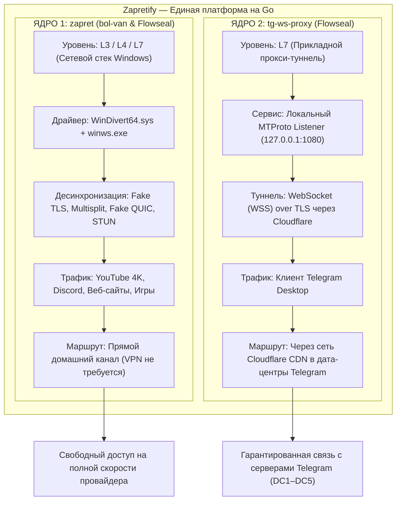

<div align="center">


# Zapretify

**Единый графический центр управления обходом блокировок для Windows**

### Симбиоз технологий `zapret` и `tg-ws-proxy` в одном приложении

[](https://golang.org)
[-0078D6?style=flat&logo=windows)](https://microsoft.com)
[](LICENSE)
[](#-планы-развития-roadmap)
[-orange)](https://github.com/Flowseal/zapret-discord-youtube)
[](https://github.com/Flowseal/tg-ws-proxy)

*Легковесное десктопное приложение на Go и WebView2 (~15 МБ ОЗУ), объединяющее низкоуровневую десинхронизацию DPI (YouTube, Discord) и защищенный WebSocket-прокси для Telegram.*

[О концепции](#-о-концепции-zapretify) • [Два ядра проекта](#-два-фундаментальных-ядра-проекта) • [Возможности](#-возможности) • [Планы развития](#-планы-развития-roadmap) • [Установка](#-установка-и-запуск) • [Использование](#-руководство-по-использованию) • [Сборка](#-сборка-из-исходников) • [Первоисточники](#-первоисточники-и-лицензии)

</div>

---

## 💡 О концепции Zapretify

Большинство существующих решений для обхода цензуры решают задачи фрагментарно:
- Для оживления **YouTube** и **Discord** пользователи запускают консольные `.bat`-скрипты на базе `zapret`.
- Для стабильной работы **Telegram** в условиях блокировок протокола MTProto и IP-адресов дата-центров поднимают отдельные WebSocket-мосты (`tg-ws-proxy`) или ищут сторонние прокси.

Запуск нескольких разрозненных скриптов, командных строк и фоновых процессов неудобен, нагружает систему и требует регулярного ручного обслуживания.

**Zapretify** решает эту проблему, объединяя под единым управлением **два принципиально разных инструмента обхода блокировок**:
1. **Низкоуровневый драйверный перехватчик `zapret`** (ядро bol-van + пакет актуальных стратегий Flowseal).
2. **Прикладной прокси-мост `tg-ws-proxy`** (WebSocket / Fake-TLS туннелирование для Telegram).

Оба инструмента управляются единым оркестратором на Go, имеют независимые тумблеры переключения, не конфликтуют между собой и доступны через современный графический интерфейс с поддержкой системного трея Windows.

---

## 🧩 Два фундаментальных ядра проекта



| Характеристика | ЯДРО 1: `zapret` (bol-van & Flowseal) | ЯДРО 2: `tg-ws-proxy` (Flowseal) |
|---|---|---|
| **Сетевой уровень** | **L3 / L4 / L7** (Сетевой стек Windows) | **L7** (Прикладной прокси-мост) |
| **Механизм работы** | Драйвер ядра **WinDivert** + десинхронизация пакетов | Локальный TCP-сервер -> WebSocket over TLS через Cloudflare |
| **Что защищает** | **YouTube**, **Discord** (включая голос), сайты, игры | Мессенджер **Telegram Desktop** |
| **Внешний сервер** | **Не требуется** (100% скорости домашнего канала) | Cloudflare Edge CDN / Workers |
| **Первоисточники** | [bol-van/zapret](https://github.com/bol-van/zapret)<br>[Flowseal/zapret-discord-youtube](https://github.com/Flowseal/zapret-discord-youtube) | [Flowseal/tg-ws-proxy](https://github.com/Flowseal/tg-ws-proxy) |

### 1. Ядро `zapret` (bol-van) с базой стратегий Flowseal
- **Что это**: мощнейший инструмент обхода DPI (глубокого анализа пакетов) без маршрутизации трафика через удаленные VPN-серверы.
- **Как это устроено**:
  - Использует подписанный драйвер уровня ядра **WinDivert** (`WinDivert.dll`, `WinDivert64.sys`) для фильтрации и модификации исходящих пакетов TCP/UDP прямо на сетевой карте.
  - Утилита `winws.exe` выполняет десинхронизацию пакетов: разбивает TLS ClientHello на части (`split`, `multisplit`, `fakedsplit`), генерирует фиктивные пакеты с заниженным TTL/SEQ (`fake`, `badseq`), подменяет SNI на разрешенные (`www.google.com`, `ya.ru`) и модифицирует QUIC/STUN пакеты для YouTube и Discord.
  - Наработки **Flowseal** предоставляют набор из **22 адаптированных стратегий** под реалии ТСПУ российских операторов и актуальные базы доменов (`list-general.txt`, `list-google.txt`, `ipset-all.txt`).
- **Задачи в Zapretify**: полное восстановление скорости YouTube (воспроизведение 4K 60fps), разблокировка голосовых каналов и звонков Discord, доступ к сайтам без снижения скорости провайдера.

### 2. Ядро `tg-ws-proxy` (Telegram WebSocket Proxy)
- **Что это**: специализированный локальный прокси-сервер, разработанный для гарантированной доставки трафика Telegram через любые сетевые фильтры.
- **Как это устроено**:
  - Клиент Telegram подключается к локальному адресу (по умолчанию `127.0.0.1:1080` или `1443`).
  - Прокси принимает бинарный поток MTProto и инкапсулирует его в защищенное **WebSocket (WSS)** соединение с шифрованием TLS.
  - Трафик направляется через глобальную сеть CDN **Cloudflare** (Cloudflare Workers / Edge Nodes).
  - Для интернет-провайдера и систем ТСПУ этот трафик выглядит как легитимный HTTPS/WSS веб-серфинг на доверенные адреса Cloudflare. Блокировка стандартных портов и IP-диапазонов Telegram перестает действовать.
- **Задачи в Zapretify**: мгновенное подключение Telegram к дата-центрам (DC1–DC5), быстрая загрузка медиафайлов и стабильные звонки даже в условиях точечной блокировки протокола MTProto.

---

## ⚙️ Как это работает внутри Zapretify

```mermaid
graph TD
    subgraph "Клиентская система (Windows)"
        AppUI["Графический интерфейс Zapretify (WebView2)"]
        Tray["Системный трей Windows (ПКМ-меню)"]
        
        Browser["Браузер / Discord / Игры"]
        Telegram["Клиент Telegram Desktop"]
    end

    subgraph "Zapretify Core (Единый процесс на Go)"
        EngineController["Оркестратор служб (app.go)"]
        Bench["Бенчмарк-движок"]
        UpstreamSync["Синхронизатор Flowseal"]
        
        ZapretSubsystem["Служба Zapret Manager"]
        TGProxySubsystem["Локальный TG WS Proxy Сервер"]
    end

    subgraph "Низкоуровневая обработка"
        Winws["winws.exe"]
        WinDivert["Драйвер WinDivert64.sys"]
    end

    subgraph "Внешняя сеть (Интернет)"
        YouTube["YouTube / Google CDN"]
        Discord["Серверы Discord Voice"]
        CFWorker["Cloudflare CDN / Workers (WSS)"]
        TGServers["Telegram Data Centers (DC1-DC5)"]
    end

    Tray -->|Управление службами| EngineController
    AppUI -->|Управление / Настройки| EngineController
    EngineController --> ZapretSubsystem
    EngineController --> TGProxySubsystem
    EngineController --> Bench
    EngineController --> UpstreamSync

    Browser -->|Обычный TCP/UDP трафик| WinDivert
    WinDivert <-->|Захват и модификация пакетов| Winws
    Winws -->|Десинхронизированные пакеты (DPI bypass)| YouTube
    Winws -->|QUIC / STUN десинхронизация| Discord

    Telegram -->|Локальный MTProto (127.0.0.1:1080)| TGProxySubsystem
    TGProxySubsystem -->|WebSocket over TLS (Маскировка)| CFWorker
    CFWorker -->|MTProto Forwarding| TGServers
```

### Принципы интеграции:
1. **Разделение зон ответственности**:
   - Трафик браузеров, Discord и системы идет напрямую через сетевую карту, где драйвер `WinDivert` «на лету» изменяет пакеты для обхода DPI без потери скорости.
   - Трафик Telegram идет в локальный порт `tgproxy`, где преобразуется в защищенный WebSocket-туннель.
2. **Исключение взаимного влияния**:
   - В списки исключений Zapret (`ipset-exclude.txt`, `list-exclude.txt`) занесены порты и служебные адреса прокси, что предотвращает двойную модификацию трафика.
3. **Единый мониторинг и управление**:
   - Состояния обоих сервисов опрашиваются асинхронно. В системном трее и на главном экране всегда отображаются актуальные тумблеры: можно держать включенным только Zapret, только TG-прокси, либо оба сразу.
4. **Подключение Telegram в один клик**:
   - Приложение автоматически генерирует персональную ссылку формата `tg://proxy?server=127.0.0.1&port=...&secret=...`. Кнопка в интерфейсе сразу открывает Telegram с готовым диалогом включения прокси.

---

## ✨ Возможности

### 🖥️ Современный интерфейс и интеграция с Windows
- **Тёмная цветовая гамма**: глубокие тона фона (`#0b0e14`, `#121824`) с неоновыми teal/cyan акцентами.
- **Поддержка DWM Dark Mode**: тёмный заголовок окна Windows, тёмные полосы прокрутки.
- **Фиксированный эргономичный размер**: 1060×700 с защитой от случайного размытия верстки.
- **Минимальное потребление памяти**: легковесный движок на Go + WebView2 требует всего ~15–20 МБ ОЗУ (в отличие от Electron-аналогов на 200+ МБ).

### 🔔 Управление из системного трея (ПКМ)
- Сворачивание по нажатию кнопки минимизации или закрытия.
- **Интерактивное контекстное меню**:
  - `Открыть Zapretify`;
  - `Включить / Выключить Zapret` (динамический статус);
  - `Включить / Выключить Telegram прокси` (динамический статус);
  - `Выход` с чистым завершением дочерних процессов.
- Информативный тултип при наведении курсора.

### 🧪 Автоматический бенчмарк стратегий (AutoBenchmark)
- Тестирование всех **22 доступных стратегий Flowseal** по пулу адресов (YouTube, Discord, CDN).
- Поддержка проверки через Ping, HTTPS и DPI-десинхронизацию.
- Расчет метрики доступности и задержки с автовыбором лучшей стратегии.
- Автоматическая запись отчета в `test_results.txt`.

### 🔄 Автообновление баз и стратегий из Flowseal
- Синхронизация всех 5 баз списков хостов (`list-general.txt`, `list-google.txt`, `list-exclude.txt`, `ipset-exclude.txt`, `ipset-all.txt`).
- Загрузка и синтаксический разбор 22 сценариев `.bat` из репозитория Flowseal.
- Горячее обновление `strategies.json` без необходимости перезапускать приложение.

### ⚙️ Режим системной службы Windows
- Возможность запуска в виде фонового процесса либо регистрация в диспетчере служб Windows (`sc.exe`).
- Служба работает автономно до входа пользователя в систему.

### 📝 Встроенный редактор списков и журнал логов
- Редактирование пользовательских и общих списков доменов прямо в окне программы.
- Живой просмотр логов `zapretify.log` с автопрокруткой и кнопка аварийной остановки процессов.

---

## 📦 Установка и запуск

### Вариант 1: Portable-версия (без установки)
1. Скачайте архив **`Zapretify-Portable-v1.0.0.zip`** из раздела [Releases](../../releases).
2. Распакуйте архив в удобный каталог (например, `C:\Program Files\Zapretify` или `D:\Tools\Zapretify`).
3. Запустите **`Zapretify.exe`** от имени администратора.

### Вариант 2: Установщик Windows (Setup.exe)
1. Скачайте и запустите **`Zapretify-Setup-v1.0.0.exe`** из раздела [Releases](../../releases).
2. Программа установки:
   - Автоматически предложит оптимальный путь установки с возможностью выбора другой папки;
   - Создаст ярлыки на рабочем столе и в меню «Пуск»;
   - Настроит автозапуск в трей и системную службу Windows;
   - Корректно зарегистрирует программу в системе для чистого удаления через стандартные «Параметры Windows -> Приложения».

> **Обратите внимание**: для перехвата сетевых пакетов драйвер **WinDivert** требует права локального администратора. Приложение запросит UAC при старте.

---

## 📖 Руководство по использованию

### 1. Настройка Zapret (YouTube и Discord)
1. Откройте вкладку **«Бенчмарк»** и нажмите кнопку **«Запустить тестирование»**.
2. Алгоритм протестирует 22 стратегии на вашей линии связи и выделит победителя (например, `General [EXP]`).
3. Нажмите **«Применить лучшую стратегию»**.
4. На главной странице включите тумблер **«Zapret»**. YouTube и Discord начнут работать без замедлений.

### 2. Настройка Telegram Прокси
1. На главной странице включите тумблер **«Telegram Прокси»**.
2. Нажмите появившуюся кнопку **«Подключить в Telegram»**.
3. В открывшемся приложении Telegram подтвердите включение прокси.
4. Telegram переключится на локальный WebSocket-мост и будет мгновенно соединяться с серверами.

---

## 🛠️ Сборка из исходников

### Требования
- **Go**: версия `1.22` или новее.
- **ОС**: Windows 10/11 x64, macOS или Linux (с поддержкой Go cross-compilation).

### Компиляция
```bash
# Кросс-компиляция из Linux или macOS:
GOOS=windows GOARCH=amd64 go build -ldflags="-s -w -H=windowsgui" -o Zapretify.exe .

# Нативная компиляция в Windows:
go build -ldflags="-s -w -H=windowsgui" -o Zapretify.exe .

# Сборка инсталлятора (Setup.exe):
GOOS=windows GOARCH=amd64 go build -ldflags="-s -w -H=windowsgui" -o dist/Zapretify-Setup-v1.0.0.exe ./cmd/installer
```

### Автоматическая сборка дистрибутива
В Windows запустите:
```cmd
build_all.bat
```
Скрипт скомпилирует `Zapretify.exe`, упакует портативный архив `dist/Zapretify-Portable-v1.0.0.zip` и автоматически соберет инсталлятор `dist/Zapretify-Setup-v1.0.0.exe`.

---

## 🗺️ Планы развития (Roadmap)

В текущей версии реализован полнофункциональный клиент для **Windows 10/11 x64**. В дальнейших релизах запланирована активная адаптация и оптимизация под другие платформы:

- [x] **Windows 10 / 11 (x64)**:
  - Полная поддержка WinDivert, системной службы Windows (`sc.exe`), автозапуска, системного трея и графического инсталлятора.
- [ ] **Оптимизация под Linux**:
  - Адаптация ядра под `nfqws` (Netfilter Queue) из оригинального комплекса zapret bol-van;
  - Управление правилами маршрутизации через `iptables` / `nftables` и фоновым сервисом `systemd`;
  - Сборка пакетов `.deb`, `.rpm`, `.AppImage` и поддержка headless CLI-режима.
- [ ] **Оптимизация под macOS**:
  - Интеграция с подсистемой перехвата пакетов macOS через Packet Filter (`pf`) и `divert-sockets`;
  - Нативная сборка универсального бандла `.app` / `.dmg` для архитектур **Apple Silicon (M1–M4 / ARM64)** и **Intel (x86_64)**;
  - Адаптация интерфейса под системный статус-бар macOS (Menu Bar) с темной темой.

---

## 📂 Структура репозитория

```text
Zapretify/
├── assets/                   # Иконки приложения (.ico, .png, .bmp) и логотипы
├── bin/                      # Бинарные модули ядра
│   ├── winws.exe             # Исполняемый файл zapret (bol-van)
│   ├── WinDivert.dll         # Библиотека перехвата пакетов WinDivert
│   ├── WinDivert64.sys       # 64-битный драйвер уровня ядра
│   ├── cygwin1.dll           # POSIX-совместимый слой
│   └── *.bin                 # Бинарные пэйлоады (Google SNI, QUIC, Discord STUN)
├── cmd/                      # Точки входа дополнительных утилит
│   └── installer/            # Графический инсталлятор для Windows (Go + WebView2)
│       ├── frontend/         # Веб-интерфейс мастера установки
│       ├── main.go           # Движок распаковки, ярлыков и реестра Windows
│       └── window_windows.go # Win32 окно с темным заголовком DWM
├── core/                     # Исходный код бэкенда (Go)
│   ├── config/               # Менеджер настроек (JSON) и реестр автозапуска
│   ├── logger/               # Потокобезопасный логгер в zapretify.log
│   ├── platform/             # Win32 API, UAC elevation, системная диагностика
│   ├── tgproxy/              # Реализация ядра tg-ws-proxy (WebSocket MTProto bridge)
│   ├── updater/              # Синхронизатор баз и стратегий Flowseal
│   └── zapret/               # Диспетчер процесса winws, WinDivert, бенчмарк, служба
├── frontend/                 # Пользовательский интерфейс (Single Page Application)
│   └── dist/index.html       # Легковесный HTML5/CSS3/Vanilla JS фронтенд
├── lists/                    # Списки хостов и IP-диапазонов Flowseal
├── packaging/                # Резервные скрипты установщика Inno Setup (installer.iss)
├── api.go                    # Внутренний HTTP REST API для связи GUI с Go-ядром
├── app.go                    # Главный контроллер приложения и фасад управления
├── build_all.bat             # Скрипт сборки Portable архива и инсталлятора
├── main.go                   # Точка входа приложения, встроенный веб-сервер
├── strategies.json           # Локальная база 22 стратегий Flowseal
├── window_windows.go         # Интеграция с Win32: WebView2, системный трей, DWM Dark Mode
└── window_other.go           # Заглушки для кросс-платформенной компиляции
```

---

## 🙏 Первоисточники и лицензии

Проект **Zapretify** выражает глубокую признательность авторам базовых технологий:

1. **[bol-van/zapret](https://github.com/bol-van/zapret)**  
   *Автор: bol-van*  
   Оригинальный комплекс `zapret`, утилита `winws.exe`, интеграция с сетевым драйвером `WinDivert` и реализация передовых методов десинхронизации пакетов.  
   Лицензия: [MIT License](https://github.com/bol-van/zapret/blob/master/docs/LICENSE.txt).

2. **[Flowseal/zapret-discord-youtube](https://github.com/Flowseal/zapret-discord-youtube)**  
   *Автор: Flowseal*  
   Готовые стратегии для обхода замедления YouTube и Discord в РФ, базы доменов и IP-диапазонов, бинарные пэйлоады.  
   Лицензия: [MIT License](https://github.com/Flowseal/zapret-discord-youtube/blob/main/LICENSE).

3. **[Flowseal/tg-ws-proxy](https://github.com/Flowseal/tg-ws-proxy)**  
   *Автор: Flowseal*  
   Концепция и реализация проксирования протокола Telegram MTProto через защищенные соединения WebSocket (WSS) и CDN-сети.  
   Лицензия: [MIT License](https://github.com/Flowseal/tg-ws-proxy/blob/main/LICENSE).

Лицензия проекта Zapretify — **[MIT License](LICENSE)**.
