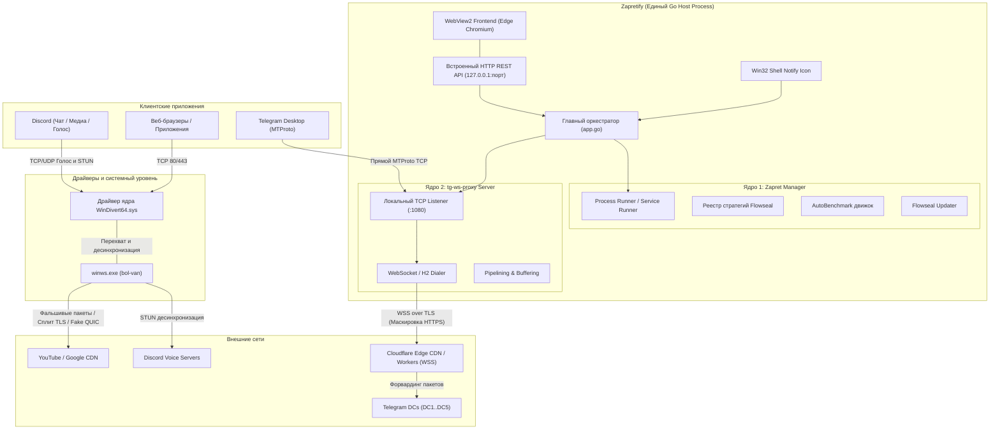

# Техническая архитектура Zapretify

Документ описывает внутреннее устройство, архитектурные слои, механизм совмещения двух ключевых технологий (**`zapret`** и **`tg-ws-proxy`**), межпроцессное взаимодействие (IPC) и спецификацию внутренних API приложения **Zapretify**.

---

## 1. Архитектурная концепция: объединение двух разных технологий

Главная инженерная задача Zapretify — устранить фрагментацию инструментов обхода цензуры и объединить **два принципиально различных механизма** в один стабильный процесс:

1. **L3/L4/L7 Пакетная десинхронизация (`zapret`)**:
   - Работает на уровне сетевого адаптера через драйвер ядра **WinDivert**.
   - Не направляет трафик на сторонние прокси/VPN-серверы, сохраняя 100% скорости домашнего канала.
   - Модифицирует заголовки TCP/UDP пакетов (TLS ClientHello, QUIC, STUN), ослепляя системы ТСПУ/DPI для YouTube, Discord и веб-сайтов.

2. **L7 Прикладной транспортный туннель (`tg-ws-proxy`)**:
   - Работает как локальный прокси-сервер на уровне приложения.
   - Перехватывает бинарный протокол Telegram MTProto и упаковывает его в защищенное соединение **WebSocket (WSS)** через Cloudflare CDN/Workers.
   - Обеспечивает бесперебойную работу Telegram даже в условиях полной блокировки официальных IP-адресов дата-центров (DC1–DC5) или сигнатур протокола MTProto.

---

## 2. Общая схема потоков данных и сетевого разделения

---

## 3. Ключевые подсистемы ядра

### 3.1. Подсистема Zapret (`core/zapret`)
- **Режимы работы**:
  1. *Пользовательский процесс (User Mode)*: запуск `bin/winws.exe` с аргументами выбранной стратегии через `exec.Command` с флагами сокрытия окон (`CREATE_NO_WINDOW`, `HideWindow: true`).
  2. *Системная служба Windows (Service Mode)*: интеграция с диспетчером служб Windows через `sc.exe create zapret ... start= auto`. Служба стартует до входа пользователя в Windows.
- **Обработка аргументов**:
  - Подстановка системных макросов: `%BIN%` (путь к бинарным файлам рукопожатий TLS/QUIC), `%LISTS%` (путь к хост-листам), `%GameFilterTCP%`/`%GameFilterUDP%` (порты игровых протоколов).
- **Изоляция сетевого трафика**:
  - Локальные порты прокси (`1080`, `1443`) и локальный интерфейс `127.0.0.1` исключены из фильтрации WinDivert во избежание рекурсивного перехвата.

### 3.2. Подсистема `tg-ws-proxy` (`core/tgproxy`)
- **Архитектура сервера**:
  - Реализован на чистом Go с использованием `github.com/gorilla/websocket`.
  - Запускает локальный TCP listener настраиваемого порта (по умолчанию `127.0.0.1:1080` или `1443`).
- **Туннелирование**:
  - При поступлении соединения от клиента Telegram, сервер устанавливает защищенное WebSocket-соединение (`wss://<worker-domain>/api`) с Cloudflare Workers.
  - Полнодуплексный конвейер данных (`clientConn <-> wsConn`) с буферизацией по 32 КБ.
  - Резервный режим: прямое TCP-подключение к Telegram DC2 (`149.154.167.220:443`) при отключенном режиме CF Worker.

### 3.3. Автоматический бенчмарк стратегий (`core/zapret/tester.go`)
- **Алгоритм тестирования**:
  1. Временная остановка фоновой службы для обеспечения чистоты замеров.
  2. Перебор доступных стратегий Flowseal:
     - Запуск `winws.exe` с тестируемыми флагами;
     - Прогрев драйвера WinDivert (400 мс);
     - Проверка контрольных доменов (YouTube GGC, Discord, Cloudflare) методами Ping, HTTPS handshake или DPI probe;
     - Замер процента успешных ответов и средней задержки (RTT);
     - Завершение тестового процесса.
  3. Ранжирование по стабильности (`Score = SuccessRate * 1000 - AvgLatency`).
  4. Запись отчета в файл `test_results.txt`.

### 3.4. Upstream-синхронизатор Flowseal (`core/updater`)
- **Списки хостов**:
  - Скачивание `list-general.txt`, `list-google.txt`, `list-exclude.txt`, `ipset-exclude.txt`, `ipset-all.txt` из `raw.githubusercontent.com`.
  - Атомарная запись через временные файлы (`.download` -> `os.Rename`).
- **Синхронизация стратегий**:
  - Динамический опрос GitHub API репозитория Flowseal на предмет обнаружения новых пакетных файлов `general*.bat`.
  - Параллельная загрузка содержимого файлов через пул воркеров.
  - Функция `ParseBatRawArgs`: очистка от управляющих символов `^`, сборка аргументов `winws.exe`, обновление `strategies.json` и вызов `zapret.GetRegistry().Load()` для горячей перезагрузки стратегий в памяти без перезапуска приложения.

### 3.5. Win32 и оконный уровень (`window_windows.go`)
- **WebView2 Integration**: встраивание легковесного веб-движка Microsoft Edge Chromium.
- **Windows DWM Dark Mode**: вызов `DwmSetWindowAttribute(hwnd, DWMWA_USE_IMMERSIVE_DARK_MODE, ...)` для отображения нативного тёмного заголовка окна.
- **Системный трей Windows**:
  - Регистрация иконки через `Shell_NotifyIconW`.
  - Обработка клика правой кнопкой мыши (`WM_RBUTTONUP`) с вызовом нативного меню (`TrackPopupMenuEx`).
  - Асинхронные команды включения/выключения Zapret и Telegram прокси.

---

### 3.6. Архитектура внедрения зависимостей (Dependency Injection)
- Структура `App` инкапсулирует состояние и зависимости приложения:
  - `cfg *config.Config` — конфигурационный профиль;
  - `runner *zapret.ProcessRunner` — жизненный цикл фонового процесса `winws.exe`;
  - `registry *zapret.StrategyRegistry` — реестр доступных стратегий десинхронизации;
  - `tgServer *tgproxy.Server` — встроенный сервер MTProto WebSocket прокси.
- Конструктор `NewAppWith(cfg, runner, registry, tgServer)` позволяет изолированно создавать экземпляры приложения в unit-тестах с использованием mock-объектов и `httptest.Server`, без глобальных побочных эффектов.

### 3.7. Модель безопасности локального API (`security_middleware.go`)
- **Защита от DNS Rebinding**:
  - Строгая валидация заголовка `Host`. Разрешены только `127.0.0.1:<port>` и `localhost:<port>`. Любые внешние домены отклоняются с кодом `403 Forbidden`.
- **Защита от CSRF и межсайтовых запросов из браузера**:
  - Проверка заголовков `Origin` и `Sec-Fetch-Site`. Запросы с происхождением `null` (песочницы iframe, file URI) и `cross-site` блокируются.
- **Сессионная аутентификация**:
  - При старте генерируется криптографически стойкий 16-байтный случайный токен сессии (`sessionToken`), передаваемый WebView2 через query-параметр при инициализации.
  - Все последующие AJAX/Fetch вызовы к `/api/*` обязаны передавать заголовок `X-Zapretify-Token`. Вызовы без токена или с неверным токеном отклоняются с кодом `401 Unauthorized`.
- **Защита от отказа в обслуживании (DoS)**:
  - Ограничение размера тела запросов: не более 1 МБ для конфигурации (`/api/config`) и не более 5 МБ для списков (`/api/lists`).
  - Строгая валидация HTTP методов: мутационные маршруты требуют `POST` (возвращая `405 Method Not Allowed` при `GET`), а маршруты чтения требуют `GET`.

---

## 4. Спецификация внутреннего REST API (`api.go`)

| Метод | Эндпоинт | Описание |
|---|---|---|
| `GET` | `/api/status` | Статус Zapret, TG-прокси, версии, ссылки подключения и активности подбора (`benchmark`) |
| `GET` | `/api/config` | Текущая конфигурация приложения (`config.json`) |
| `POST` | `/api/config` | Сохранение настроек (поддержка частичного обновления, лимит 1 МБ) |
| `GET` | `/api/zapret/strategies` | Список доступных стратегий Flowseal с параметрами |
| `POST` | `/api/zapret/start?strategy=...` | Запуск `winws.exe` с выбранной стратегией |
| `POST` | `/api/zapret/stop` | Остановка процесса или службы Zapret |
| `POST` | `/api/zapret/install-service?strategy=...` | Установка системной службы Windows zapret |
| `POST` | `/api/zapret/remove-service` | Удаление системной службы Windows zapret |
| `POST` | `/api/zapret/force-kill` | Аварийный сброс: завершение всех процессов `winws.exe` в системе (единственное место глобального `taskkill`) |
| `POST` | `/api/zapret/reset-drivers` | Полный сброс драйвера ядра WinDivert и связанных служб |
| `POST` | `/api/zapret/benchmark?strategy=...&method=...&targets=...` | Асинхронный запуск теста одной стратегии (`{"status":"started"}`) |
| `GET` | `/api/zapret/benchmark/status` | Получение статуса и результатов теста одной стратегии |
| `POST` | `/api/zapret/benchmark-all?method=...&targets=...` | Асинхронный запуск бенчмарка всех стратегий |
| `GET` | `/api/zapret/benchmark-all/status` | Опрос прогресса и лидерборда бенчмарка всех стратегий |
| `POST` | `/api/zapret/benchmark-all/stop` | Остановка подбора; результаты по проверенным стратегиям сохраняются |
| `GET` | `/api/zapret/benchmark-all/last` | Итог последнего подбора из `last_benchmark.json` (`null`, если подбора не было) |
| `GET` | `/api/zapret/targets?group=...` | Получение списка контрольных адресов по группам |
| `POST` | `/api/zapret/open-test-log` | Открытие файла `test_results.txt` в системном редакторе |
| `GET` | `/api/zapret/test-log` | Чтение содержимого `test_results.txt` |
| `GET` | `/api/zapret/ipset-mode` | Получение текущего режима IPSet (`none`, `loaded`, `any`) |
| `POST` | `/api/zapret/ipset-mode?mode=...` | Переключение режима IPSet |
| `POST` | `/api/tg/start` | Запуск локального MTProto WebSocket прокси-сервера |
| `POST` | `/api/tg/stop` | Остановка локального MTProto WebSocket прокси-сервера |
| `GET` | `/api/tg/ping` | Замер задержки (RTT) до дата-центров Telegram (DC1–DC5) |
| `GET` | `/api/diagnostics` | Проверка TCP Timestamps, WinDivert и конфликтов GoodbyeDPI |
| `POST` | `/api/platform/restart-admin` | Перезапуск приложения с запросом прав администратора |
| `POST` | `/api/platform/fix-tcp` | Автоматическая оптимизация сетевого стека Windows (TCP Timestamps) |
| `GET` | `/api/updater/check` | Проверка наличия новой версии приложения на GitHub |
| `POST` | `/api/updater/assets` | Запуск фоновой синхронизации хост-листов и стратегий из upstream Flowseal (возвращает `{"status":"started"}`) |
| `GET` | `/api/updater/assets/status` | Статус синхронизации: `running`, `done`, `summary`, `error` |
| `GET` | `/api/lists?file=...` | Чтение содержимого хост-листа |
| `POST` | `/api/lists?file=...` | Сохранение хост-листа (белый список разрешенных файлов) |
| `GET` | `/api/logs` | Чтение последних строк журнала `zapretify.log` |
| `POST` | `/api/logs/clear` | Очистка журнала событий |
| `GET` | `/api/debug-report` | Формирование сводного диагностического отчета для отладки |
| `POST` | `/api/open-url?url=...` | Безопасное открытие внешнего URL (проверка разрешенных хостов) |
| `POST` | `/api/app/force-exit` | Корректное завершение работы приложения со всеми дочерними службами |

