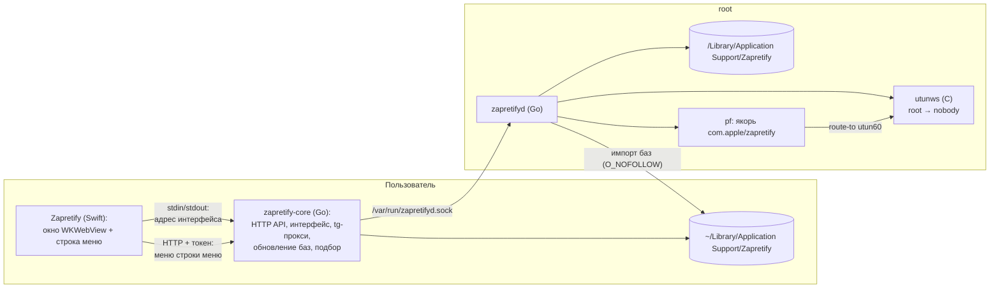

# Архитектура Zapretify для macOS

Документ описывает, как устроена macOS-версия Zapretify (с 1.5.0): процессы и их права, служба
`zapretifyd`, движок `utunws`, перехват трафика через `pf`, перевод стратегий Flowseal, оболочка
приложения, установка, обновление и удаление. Общая часть (интерфейс, API, Telegram-прокси, обновление
баз, подбор стратегий) описана в [ARCHITECTURE.md](ARCHITECTURE.md), модель угроз службы — в
[macos/SECURITY.md](../macos/SECURITY.md).

---

## 1. Главная идея

На Windows Zapretify сам запускает `winws.exe`, а драйвер WinDivert перехватывает пакеты. На macOS
перехват требует прав root, а приложение от root работать не должно. Поэтому macOS-версия разделена на
две части:

- **Приложение** (`Zapretify.app`) работает от имени пользователя: окно, значок в строке меню, то же
  Go-ядро, что на Windows. Оно только просит службу «запусти стратегию X» или «остановись».
- **Служба** `zapretifyd` (LaunchDaemon, root) — единственная часть с правами root. Она проверяет
  запросы и базы, переводит стратегию, запускает движок `utunws` и настраивает `pf`. Ставится один раз
  из приложения с паролем администратора, после этого обход включается и выключается без пароля.

Всё ядро Zapretify выше уровня «запусти движок» общее для Windows и macOS: интерфейс работает с
интерфейсом `Engine` (`core/zapret/engine.go`), а не с конкретным движком.



---

## 2. Процессы, файлы и права

| Что | Где | Владелец / права |
|---|---|---|
| Оболочка `Zapretify` (Swift) | `Zapretify.app/Contents/MacOS/Zapretify` | пользователь |
| Ядро `zapretify-core` (Go) | `Zapretify.app/Contents/MacOS/zapretify-core` | пользователь |
| Базы для первого запуска | `Zapretify.app/Contents/Resources/{strategies.json,lists,bin}` | только чтение |
| Файлы для установки службы | `Zapretify.app/Contents/Resources/daemon/` (`zapretifyd`, `utunws`, `install-daemon.sh`, `uninstall-daemon.sh`) | только чтение |
| Данные пользователя | `~/Library/Application Support/Zapretify` (`config.json`, `zapretify.log`, `strategies.json`, `lists/`, `bin/`, `assets-backup/`) | пользователь |
| Служба | `/Library/Application Support/Zapretify/zapretifyd` | root:wheel 0755 |
| Движок | `/Library/Application Support/Zapretify/engine/utunws` | root:wheel 0755 |
| Копия баз для движка | `/Library/Application Support/Zapretify/{lists,bin}` | root:wheel, файлы 0644 |
| Владелец службы | `/Library/Application Support/Zapretify/daemon.json` (`owner_uid`, `app_path`) | root:wheel 0644 |
| Состояние | `/Library/Application Support/Zapretify/state.json` (`boot`, `strategy`) | root |
| LaunchDaemon | `/Library/LaunchDaemons/io.github.selfdestroyer.zapretifyd.plist` (`RunAtLoad`, `KeepAlive`) | root:wheel 0644 |
| Сокет | `/var/run/zapretifyd.sock` | 0666, доступ проверяется по uid |
| Конфиг движка | `/var/run/zapretify.conf` | root 0600 |
| Журнал службы | `/Library/Logs/Zapretify/zapretifyd.log` | root |
| Автозапуск приложения | `~/Library/LaunchAgents/io.github.selfdestroyer.zapretify.plist` | пользователь |

Папка данных берётся из `config.AppDir()`: на Windows — папка рядом с `.exe`, на macOS —
`~/Library/Application Support/Zapretify` (сам `.app` только для чтения). При первом запуске
`prepareAppDir` копирует туда недостающие базы из `Contents/Resources`, существующие файлы не трогает.

---

## 3. Оболочка и ядро

`macos/app/Shell.swift` — тонкая оболочка на AppKit:

1. **Один экземпляр.** Если Zapretify уже запущен, новая копия шлёт распределённое уведомление
   «покажи окно» и выходит.
2. **Запуск ядра.** `zapretify-core` стартует с `ZAPRETIFY_SHELL=1`, его stdin и stdout — каналы оболочки.
   Ядро поднимает API на `127.0.0.1:<случайный порт>` и печатает строку `ZAPRETIFY_URL <адрес с токеном>`
   (и `ZAPRETIFY_MINIMIZED`, если запуск свёрнутым). Аргументы оболочки (`--minimized` от автозапуска)
   передаются ядру.
3. **Окно.** `WKWebView` 720×380 загружает интерфейс. Заголовок окна прозрачный
   (`fullSizeContentView`), кнопки окна перенесены в шапку интерфейса (по центру шапки высотой 54 pt),
   шапка перетаскивает окно: скрипт в странице присылает `mousedown` по пустому месту шапки, оболочка
   вызывает `performDrag`. Интерфейс получает класс `mac-shell` и сдвигает шапки под кнопки окна.
   Ссылки за пределы `127.0.0.1` открываются в браузере по умолчанию. Меню «Правка» нужно для ⌘C/⌘V
   в полях интерфейса.
4. **Строка меню.** Значок — логотип с кружком состояния (зелёный — Zapret и Telegram-прокси, оранжевый —
   одно из двух, красный — ничего). Состояние оболочка раз в 3 с берёт из `/api/status` с тем же
   токеном. Левый клик открывает окно, правый (или ⌃-клик) — меню: состояние, «Открыть»,
   «Включить/Выключить Zapret», «…Telegram-прокси», «Выйти».
5. **Закрытие.** Крестик прячет окно и убирает значок из Dock (`.accessory`). «Выйти» закрывает stdin
   ядра: ядро останавливает Zapret и прокси и выходит (оболочка ждёт до 8 с). Если ядро завершилось само
   («Закрыть всё»), оболочка тоже выходит.

Ядро на macOS выбирает движок `macdaemon.DaemonEngine` (`platform_darwin.go`), на остальных системах —
`zapret.GetRunner()` с `winws.exe` (`platform_other.go`).

---

## 4. Служба zapretifyd

`cmd/zapretifyd/main.go` + `core/macdaemon`.

### 4.1. Протокол

Одно соединение — один JSON-запрос и один JSON-ответ (`core/macdaemon/protocol.go`).

| Команда | Поля запроса | Что делает |
|---|---|---|
| `status` | — | состояние |
| `start` | `strategy` | импортирует базы, переводит стратегию, (пере)запускает движок; запоминает стратегию |
| `stop` | — | останавливает движок, снимает правила pf |
| `boot` | `boot`, `strategy` | включает/выключает запуск обхода при загрузке |

Ответ: `ok`, `error`, `protocol`, `version` (версия службы), `running`, `strategy`, `pid`, `iface`,
`last_exit` (почему движок остановился сам), `note` (предупреждение, например про VPN), `ipv6` (перехватывается
ли IPv6 и почему нет), `boot`, `log` (последние строки вывода движка).

Проверки на входе: uid собеседника через `LOCAL_PEERCRED` (только владелец из `daemon.json` и root),
запрос не больше 4 КБ, тайм-аут соединения 30 с. Команды выполняются по одной (`Server.mu`).

С аргументами `zapretifyd` работает как клиент: `zapretifyd status | start <стратегия> | stop`.

### 4.2. Запуск стратегии

```mermaid
sequenceDiagram
    participant C as zapretify-core
    participant D as zapretifyd (root)
    participant H as ~/Library/…/Zapretify
    participant E as utunws
    participant P as pf
    C->>D: start {"strategy": "general (ALT)"}
    D->>D: проверка uid, остановка прежнего движка
    D->>H: импорт strategies.json, lists/*.txt, bin/*.bin (openat + O_NOFOLLOW, владелец = uid)
    D->>D: перевод стратегии, белый список опций и путей
    D->>D: /var/run/zapretify.conf (0600)
    D->>D: маршрут: физический интерфейс, шлюз, MAC шлюза; есть ли VPN
    D->>E: utunws @/var/run/zapretify.conf (ZAPRET_IFACE, ZAPRET_GATEWAY_MAC, ZAPRET_UTUN_UNIT=61)
    E-->>D: создан utun60, права сброшены до nobody
    D->>D: ifconfig utun60 10.78.0.1 10.78.0.2
    D->>P: pfctl -E (токен), правила в якорь com.apple/zapretify
    D->>D: 700 мс: движок не упал
    D-->>C: running, pid, iface, note
```

1. **Импорт баз** (`importer.go`). Служба читает папку данных того пользователя, от чьего имени пришла
   команда. Домашняя папка считается доверенной, а всё ниже неё открывается по одному компоненту через
   `openat(O_NOFOLLOW|O_DIRECTORY)`: ни одна папка и ни один файл не могут быть симлинком. Каждый файл
   должен принадлежать этому пользователю (это отсекает и жёсткие ссылки), быть обычным и не больше
   лимита (стратегии 5 МБ, список 32 МБ, фейк 1 МБ). Подходящие файлы копируются в
   `/Library/Application Support/Zapretify/{lists,bin}` через временную папку и замену целиком —
   удалённые пользователем файлы исчезают и из копии.
2. **Перевод стратегии** (`core/zapret/translate.go`, раздел 6) и **проверка** (`validate.go`): только
   опции из белого списка, пути только внутри папок службы и только из символов `A-Z a-z 0-9 пробел _ . / -`.
3. **Маршрут** (`defaultRoute`): интерфейс и шлюз маршрута по умолчанию, MAC шлюза через `ping` + `arp`,
   MAC IPv6-шлюза через `ndp`. Если маршрут по умолчанию идёт в туннель — отказ («весь трафик идёт через
   VPN»). Если только часть адресов (1.1.1.1, 8.8.8.8, 77.88.8.8, 142.250.0.1) идёт через `utun`/`ppp`/`ipsec`
   — это VPN в режиме TUN: запуск продолжается, в ответе появляется `note`.
4. **Движок** запускается с чистым окружением; вывод идёт в журнал службы и в кольцевой буфер для ответа.
   Служба ждёт появления `utun60` (до 10 с), назначает адреса `10.78.0.1` → `10.78.0.2`, а если в сети есть
   IPv6-шлюз — ещё и `fd7a:7a7a:7a7a::1` → `::2`, берёт ссылку на `pf` (`pfctl -E` → токен) и загружает
   правила. Если движок завершился в первые 700 мс — всё снимается, в ошибке последние
   строки его вывода.

### 4.3. Правила pf

```
pass out quick on en0 route-to (utun60 10.78.0.2) inet proto tcp from any to any port {80,443,2053,2083,2087,2096,8443} user { >root } no state
pass out quick on en0 route-to (utun60 10.78.0.2) inet proto udp from any to any port {443,19294:19344,50000:50100} user { >root } no state
# если в сети есть IPv6 — те же порты для inet6:
pass out quick on en0 route-to (utun60 fd7a:7a7a:7a7a::2) inet6 proto tcp from any to any port {80,443,2053,2083,2087,2096,8443} user { >root } no state
pass out quick on en0 route-to (utun60 fd7a:7a7a:7a7a::2) inet6 proto udp from any to any port {443,19294:19344,50000:50100} user { >root } no state
```

- **Порты** берутся из `--wf-tcp` / `--wf-udp` выбранной стратегии, а не зашиты: если Flowseal добавит
  порт, он подхватится.
- **IPv6.** macOS открывает сайты с AAAA-записью (YouTube, `googlevideo.com`, `ytimg.com`) по IPv6, если он
  есть у провайдера. Правила только для `inet` пропускали этот трафик мимо движка, и такие сайты не
  открывались ни с одной стратегией. Правила `inet6` добавляются, когда служба нашла MAC IPv6-шлюза; если
  адрес на `utun60` назначить не удалось, обход работает по IPv4, а причина видна в `ipv6`.
- **`on en0`** — только трафик, который система отправляет через физический интерфейс. Трафик, который
  VPN в режиме TUN заворачивает в свой `utun`, не трогается: иначе он ушёл бы мимо VPN с адресом туннеля
  и соединения зависли бы.
- **`user > root`** — только трафик обычных пользователей: системные службы и сам движок (он отправляет
  пакеты через BPF) не перехватываются.
- Якорь `com.apple/zapretify` загружается штатным `pf.conf` macOS. Unit `utun` (61 → `utun60`), адреса
  `10.78.0.x` и якорь отличаются от ZapretMac (`utun50`, `10.77.0.x`, `com.apple/zapret-macos`).

### 4.4. Остановка, падение, смена сети

- **Остановка** (`teardown`): сброс якоря, `pfctl -X <токен>`, SIGTERM движку, через 3 с — SIGKILL.
- **Падение движка**: служба замечает выход процесса, снимает правила pf (трафик не уходит в мёртвый
  интерфейс) и сохраняет причину в `last_exit`.
- **Смена сети** (`watchRoute`, раз в 2 с): если сменились интерфейс или шлюз (Wi-Fi ↔ Ethernet, другая
  сеть, сон), движок перезапускается с той же стратегией и новыми интерфейсом и MAC шлюза. Если маршрута
  нет, движок останавливается с причиной.
- **Запуск службы** (`Startup`): снимаются правила и движок, оставшиеся от аварийно завершённой службы
  (`pkill` только по нашему пути к `utunws`).
- **Чужой движок**: если работает другой `utunws` (ZapretMac), служба отказывается запускать свой
  с понятной ошибкой.

### 4.5. Обход при загрузке Mac

Служба хранит в `state.json` флаг `boot` и последнюю запущенную стратегию. Флаг переключается
настройкой «Включать обход при загрузке Mac» (команда `boot`, поле `zapret.boot_start` в `config.json`).
При старте службы с `boot` она ждёт сеть и запускает стратегию для владельца (до 5 минут, попытка каждые
10 с), даже если приложение не открыто.

### 4.6. Удаление вместе с приложением

В `daemon.json` записан путь к `Zapretify.app`, из которого ставилась служба. Раз в минуту служба
проверяет, существует ли он. Если приложения нет 10 минут подряд (запас на замену при обновлении), служба
останавливает движок, снимает pf, удаляет LaunchAgent автозапуска пользователя (через `openat` без
следования симлинкам), свои файлы, журнал, plist и выгружает себя (`launchctl bootout`). Ошибка доступа
(защита конфиденциальности macOS к «Загрузкам» и т. п.) за отсутствие не считается. Данные пользователя в
`~/Library/Application Support/Zapretify` остаются.

---

## 5. Установка, обновление и удаление службы

| Действие | Где в интерфейсе | Как |
|---|---|---|
| Установка | главный экран: «Нужна служба Zapretify» → «Установить службу» | `osascript … with administrator privileges` запускает `Resources/daemon/install-daemon.sh <zapretifyd> <utunws> <uid> <путь к .app>` |
| Обновление | «Обновите службу Zapretify» (версия службы ≠ версии приложения) | то же; если обход работал, он запускается снова |
| Удаление | «Диагностика и сброс» → «Удалить службу Zapretify» | `uninstall-daemon.sh` с паролем; ещё выключаются автозапуск приложения и обход при загрузке |
| Удаление целиком | Zapretify в Корзину | служба удаляет себя сама (4.6) |

`install-daemon.sh` выгружает старую службу, копирует файлы с владельцем root, пишет `daemon.json`
(без Python: на чистой macOS его нет), plist и загружает службу (`launchctl bootstrap`). Состояние службы
ядро отдаёт в `/api/status` → `service` (`installed`, `ok`, `outdated`, `version`), кэш 2 с.

---

## 6. Стратегии Flowseal на macOS

Базы приходят из того же Windows-репозитория Flowseal, что и на Windows (`core/updater`). Стратегии
хранятся в `strategies.json` в «виндовом» виде; перевод делает служба перед каждым запуском
(`TranslateForUtunws`):

| Правило | Пример |
|---|---|
| Убираются экранирующие `^` (как это делает `cmd.exe`) | `--dpi-desync-fake-tls=^!` → `!` |
| `%BIN%`, `%LISTS%` → папки службы | `/Library/Application Support/Zapretify/lists/list-general.txt` |
| `--wf-tcp`, `--wf-udp` (WinDivert) удаляются, порты уходят в правила pf | `80,443,…,%GameFilterTCP%` → `80,443,…` |
| Профили (части между `--new`) с Game Filter отбрасываются | Game Filter на macOS пока нет |
| Неизвестная `--wf-*` опция или переменная `%…%` → ошибка | вместо молча сломанного профиля |

Конфиг пишется по одному аргументу в строке; значения с пробелами берутся в кавычки. `utunws` разбирает
`@файл` через `wordexp`, и `@файл` заменяет всю командную строку — поэтому в значениях запрещены `$`,
`*`, `~`, кавычки, а проверка `--dry-run` пишется внутрь файла.

**Новая опция у Flowseal.** Стратегия с опцией не из белого списка не запустится: служба вернёт
«опция … не разрешена для движка», остальные стратегии работают. Поддержка добавляется вручную: опция в
`allowedOptions`, при необходимости — обновление движка, затем `TestEngineDryRun`.

---

## 7. Движок utunws

- **Исходники**: [Flowseal/zapret-mac-discord-youtube](https://github.com/Flowseal/zapret-mac-discord-youtube)
  (порт `nfqws` из [bol-van/zapret](https://github.com/bol-van/zapret) на `utun` + BPF), наш форк
  [selfdestroyer/zapret-macos-engine](https://github.com/selfdestroyer/zapret-macos-engine), ветка
  `zapretify`, код движка не изменён.
- **Сборка** (`scripts/build-universal.sh` форка): arm64 + x86_64, macOS 14+, `SOURCE_DATE_EPOCH` от
  последнего коммита (сборка воспроизводима), самопроверка `--dry-run` (правильный конфиг проходит,
  неизвестная опция отклоняется), `SHA256SUMS.txt` и `BUILDINFO.txt`. Тег `v*` публикует релиз через
  GitHub Actions (`macos-15-intel`).
- **Закрепление**: `macos/engine.lock` (версия, коммит, SHA-256). `build-app.sh` скачивает движок из
  релиза и останавливается при несовпадении хеша.
- **Работа**: создаёт `utun<unit−1>`, читает из него перенаправленные пакеты, применяет десинхронизацию и
  отправляет их через BPF на физический интерфейс с MAC шлюза. После открытия интерфейса сбрасывает права
  до `nobody`.
- **Проверка**: `ZAPRETIFY_UTUNWS=<путь> go test ./core/macdaemon -run DryRun` прогоняет все стратегии
  из `strategies.json` через настоящий движок.

---

## 8. Интерфейс на двух платформах

Один `frontend/dist/index.html` для Windows и macOS. Платформу сообщает `/api/status` (`platform`).

- Тексты Windows остаются по умолчанию; на macOS подставляются свои: атрибут `data-mac="…"` у элементов,
  функция `pf(windows, mac)` в коде, `pfText` в журнале ядра.
- Элементы только для Windows помечены `data-win` (сброс WinDivert, проверки прав и драйвера), только для
  macOS — `data-mac-only` («Удалить службу Zapretify»). Поля настроек: `win: 1` (служба Windows, Game Filter),
  `onlyMac: 1` («Включать обход при загрузке Mac»), `mac: {…}` — другие подписи на macOS.
- Диагностика на macOS: служба Zapretify, другой обходчик (`utunws` не из папки службы), VPN, подмена
  DNS, зашифрованный DNS (профиль `com.apple.dnsSettings.managed` с `DNSProtocol` HTTPS/TLS).
- VPN: значок «VPN» в шапке и подсказка при включении Zapret (на обеих платформах).
- Обновления: из релиза с файлами для обеих систем macOS берёт `.dmg` («Скачать .dmg»), Windows — `.exe`/`.zip`.
- Отчёт для разработчика на macOS: версия macOS, служба (версия, движок, стратегия, интерфейс, `ipv6`,
  `note`, `last_exit`), VPN, IPv6 в сети, зашифрованный DNS и вывод движка вместо полей Windows.
- Telegram-прокси (на обеих платформах): после 4 неудачных попыток подряд через Cloudflare без другого
  рабочего пути `/api/status` сообщает `tg_cf_blocked`. Под «Telegram» появляется красная «Ошибка», клик
  открывает настройки прокси на блоке «Если Telegram не подключается» с кнопками «Включить IPSet
  «loaded»» и добавления домена прокси в «Мои сайты».

---

## 9. Сборка и дистрибутив

```bash
bash macos/scripts/build-app.sh   # dist/macos/Zapretify.app
bash macos/scripts/build-dmg.sh   # dist/Zapretify-macOS-v<версия>.dmg
```

- `build-app.sh`: ядро и служба на Go для arm64 и amd64 → `lipo`; оболочка `swiftc` для двух архитектур;
  движок по `engine.lock`; базы и скрипты службы в `Resources`; иконка из `assets/logo.png`; подпись ad-hoc.
- `build-dmg.sh`: фон окна рисует `macos/app/dmg-background.swift` (цвета логотипа, 1x и Retina),
  расположение значков и вид окна задаёт `dmgbuild` (`macos/scripts/dmg-settings.py`, ставится в
  `dist/macos/.venv`).

---

## 10. Тесты

| Пакет | Что проверяется |
|---|---|
| `core/zapret` | перевод стратегий, все стратегии из `strategies.json` переводятся |
| `core/macdaemon` | белый список и пути, правила pf (IPv4 и IPv6), импорт баз (симлинки в папках и файлах, чужие файлы, `..`), доступ к сокету только владельцу, `TestEngineDryRun` (по запросу) |
| `core/platform` | определение зашифрованного DNS (по запросу, `ZAPRETIFY_LIVE_TESTS=1`) |
| `core/tgproxy` | шаблон Fake TLS, счётчик отказов Cloudflare; `TestLiveTelegramRoundTrip` (по запросу) — ответ Telegram через прокси в режимах dd, intermediate и Fake TLS |
| `core/updater` | выбор файла релиза для платформы, повтор загрузки после сетевой ошибки |
| корень | приложение работает через интерфейс `Engine` |

Ручная проверка — чек-лист тестировщика (вкладки macOS и Windows).

---

## 11. Ограничения

- Подпись ad-hoc: без Developer ID при первом запуске нужно «Всё равно открыть», и macOS не проверяет
  целостность файлов службы внутри `.app` до установки (см. `macos/SECURITY.md`).
- Game Filter на macOS пока не поддерживается.
- Подписи значков в окне `.dmg` рисует Finder: в светлой теме они тёмные на тёмном фоне.
- Если приложение переместить в другую папку после установки службы, через 10 минут служба удалит себя,
  и приложение предложит поставить её снова.
- Требуется macOS 14+ (ограничение движка).
